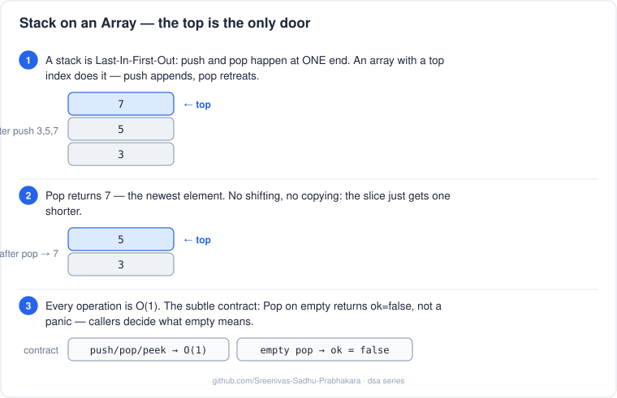

# Implement Stack Using an Array

> Striver SDE Sheet 075 · Day 13 Stack & Queue — a slice plus one index; push and pop are a write and a decrement, overflow and underflow are explicit. Go, stdlib only, tested.

## Problem

Implement a fixed-capacity stack over an array: Push, Pop, Top, Size, with overflow (full) and underflow (empty) reported rather than panicking.

## Approach

The entire state is one array and a `top` index pointing at the next free slot. Push writes and increments; Pop decrements and reads; both are O(1) with no shifting — the array's end *is* the stack's top. Making overflow/underflow return a boolean rather than panic is the API discipline worth copying: callers decide policy, the structure just reports. (Idiomatic Go would grow a slice with `append` and never overflow; the fixed-capacity form is the interview classic and the embedded-systems reality.)

**Complexity:** all operations O(1); capacity ints of storage.

## Visual walkthrough

Read the picture top to bottom — each numbered frame is one moment of the algorithm
running on this repo's test example.

## Run

    go test ./...   # verify
    go run .        # demo

---

One of 191 repos solving Striver's SDE Sheet in Go — stdlib only, one problem per repo, every solution tested. Browse the set: [`dsa-*` repos](https://github.com/Sreenivas-Sadhu-Prabhakara?tab=repositories&q=dsa-&type=source).
